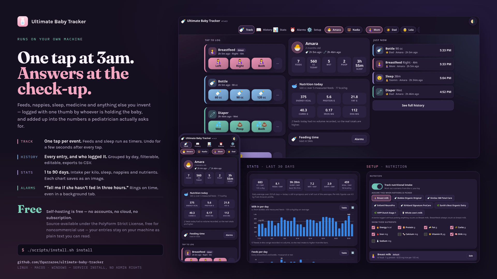

# 🍼 Ultimate Baby Tracker

[](https://ultimate-baby-tracker.safeqbit.com/demo/)
[](https://ultimate-baby-tracker.safeqbit.com)
[](https://buymeacoffee.com/fqazzazee)

[](https://fqazzazee.github.io/ultimate-baby-tracker/docs/slide/)


One-tap tracking for a newborn: feeds, diapers, sleep, baths, medicine, and
anything else you care to invent. Works in any modern browser, on a laptop, a
desktop or a phone.

**Self-hosted** and **local**: it needs no internet connection, and has no
accounts, no cloud, no build step and no dependencies. Your entries stay on your
machine as plain text you can read.

## Preview - Mobile Phone View

https://github.com/user-attachments/assets/19796da7-176f-440a-afb3-2f360b609352

### Or try it yourself, having installed nothing

**[ultimate-baby-tracker.safeqbit.com](https://ultimate-baby-tracker.safeqbit.com)**
runs the whole application in your browser, on six weeks of invented data for
two newborns and a toddler. Not a video and not screenshots — every screen is
live. Log a feed and watch it reach the charts, read the statistics, export the
CSV and open it in a spreadsheet.

It keeps what you tap in that one browser tab and nowhere else. No account, no
server, nothing shared with anybody, and closing the tab forgets all of it.

## Compatibility

Two separate questions: which machine **runs** it, and which device you **use**
it from.

**Running it.** One machine on your network holds the data and serves the app.

| | Install | In the background |
| --- | --- | --- |
| **Linux** | `./scripts/install.sh install` | systemd **user** service — no root, survives a logout, starts at boot |
| **macOS** | `./scripts/install.sh install` | no service; the install works and then prints the command to start it yourself |
| **Windows** | `.\scripts\install.cmd install` | scheduled task under your own account — starts when you log in, no administrator rights |
| **Anything else with Node 18+** | `node server.js` | by hand, or write your own unit — see [SECURITY.md](SECURITY.md#putting-it-behind-a-proxy) |
| **iOS · Android** | — | not supported — a phone is a client here, never the host |

**Using it.** A browser, over the network.

| | Browser | Installable app |
| --- | --- | --- |
| **Desktop · laptop** | any modern browser | Chrome and Edge can install the page as an app when it is opened from `localhost` or over HTTPS |
| **Android** | Chrome — the layout is built for the phone | **not yet** |
| **iPhone · iPad** | Safari — the layout is built for the phone | **not yet** |

**There is no Android or iOS app yet.** Phones are supported as browser
clients and nothing more for now — open the address, and the screen you get is
the one in the preview above.

A phone only has to reach the server, and on the same Wi-Fi it already does.
Away from home, put both ends on a VPN — WireGuard or Tailscale — or behind a
reverse proxy that adds authentication, and the phone reaches it from anywhere.
**Do not simply forward a port to it:** it has no authentication and no
encryption of its own, so anyone who finds the address is already inside. See
[SECURITY.md](SECURITY.md).

Nothing is cached for offline use either — the server has to be reachable when
you open it.

## Install

Node 18 or newer is the only prerequisite, plus git if you clone the repository.

| | Node | git |
| --- | --- | --- |
| **Fedora** | `sudo dnf install nodejs` | `sudo dnf install git` |
| **Debian 12+ · Ubuntu 24.04+** | `sudo apt install nodejs` | `sudo apt install git` |
| **Older Debian · Ubuntu** | their `nodejs` package is too old (Node 12) — use [nodejs.org](https://nodejs.org/en/download) or [NodeSource](https://github.com/nodesource/distributions) | `sudo apt install git` |
| **macOS** | the **macOS Installer (.pkg)** from [nodejs.org](https://nodejs.org/en/download) — or `brew install node` if you already use [Homebrew](https://brew.sh) | `xcode-select --install` |
| **Windows** | `winget install OpenJS.NodeJS.LTS` | `winget install Git.Git` |

**On a Mac, neither Homebrew nor git is there out of the box.** The `git` that
macOS ships is a placeholder that only offers to install Apple's Command Line
Tools, so run `xcode-select --install` once and let it finish before either of
the commands below. Check with `node --version` and `git --version`.

### Linux and macOS

```bash
git clone https://github.com/fqazzazee/ultimate-baby-tracker.git
cd ultimate-baby-tracker
./scripts/install.sh install
```

Or without cloning first:

```bash
curl -fsSL https://raw.githubusercontent.com/fqazzazee/ultimate-baby-tracker/main/scripts/install.sh | bash -s -- install
```

On Linux that sets it up as a background service that starts with your machine.
**No `sudo`, no root** — it is a systemd *user* service.

On macOS there is no service yet: the install finishes by printing the command
that starts the server. It runs for as long as that terminal window stays open.

### Windows

```powershell
git clone https://github.com/fqazzazee/ultimate-baby-tracker.git
cd ultimate-baby-tracker
.\scripts\install.cmd install
```

Or without cloning first:

```powershell
& ([scriptblock]::Create((irm https://raw.githubusercontent.com/fqazzazee/ultimate-baby-tracker/main/scripts/install.ps1))) install
```

Runs in the background from the moment you log in. **No administrator rights** —
it registers a scheduled task under your own account, not a system service.

<sub>Use `install.cmd`, not `install.ps1`. Windows blocks unsigned PowerShell
script files by default, so running the `.ps1` directly fails with *"running
scripts is disabled on this system"*. The `.cmd` is a two-line launcher that
passes <code>-ExecutionPolicy&nbsp;Bypass</code> for that one run — it changes
nothing on your machine and still needs no admin. The one-liner above sidesteps
it differently, by never writing a script file at all.</sub>

### Just try it, install nothing

```bash
node server.js     # → http://localhost:8477
```

## Then

The installer prints the address when it is done. Open it in a browser on any
device that can reach the machine, phones included.

Same three commands on either platform — `install.sh` on Linux and macOS,
`install.cmd` on Windows:

| | |
| --- | --- |
| `status` | where it is installed, and whether it is running |
| `update` | pull the newest version, and restart the service if there is one |
| `uninstall` | remove it; add `--purge` / `-Purge` to drop your entries too |

Your entries live outside the application folder and are snapshotted before
every update, so updating cannot touch them.

## What it does

| | |
| --- | --- |
| **Track** | One tap per event. Breastfeeds and sleeps are timers, and a breastfeed times each side separately — switch with one tap, and the card tells you which breast to start on next. A toast offers Undo for a few seconds after every tap. |
| **History** | Everything logged, grouped by day, filterable, editable. Exports to CSV. |
| **Stats** | Intake, feeds, diapers, sleep, pumping, nursing by side and nutrients over 1–90 days, with the figures a check-up asks for. Buttons you invent are charted too, from the fields you gave them. Pick which charts you want; each downloads as an image, or **📋 Report** puts as many as you like into one printable file. |
| **Alarms** | "Tell me if she hasn't fed in three hours." Rings on time while the page is open; allow notifications and a desktop browser nudges you from a background tab too. |
| **Setup** | Babies, people, metric or US measurements, which metrics to track and in what order, which milks to offer, which charts to draw, custom buttons, backup and restore, and backups on a schedule. |

Also: multiple babies and multiple carers (every entry records who did it),
optional 4-digit profile PINs, nutrition worked out from the cc you already log
over a rolling 24 hours to a month, metric or US units (ml/fl oz, kg/lb, cm/in,
°C/°F) with unit pairs of your own, light and dark themes, and spacing that
grows with your system text size.

## Where your data goes

Plain text, on your machine, in one folder you can copy anywhere:

```
config.json    babies, people, buttons, alarms, milk profiles, settings
events.log     one JSON object per line, append-only
timers.json    timers currently running
alarms.json    snooze / last-fired state
backup-state.json   when the last automatic backup ran
backups/       automatic backups, once you switch them on
```

**Setup → Data** downloads the lot as one compressed file and restores it again.

**Setup → Automatic backup** does it on a schedule instead, daily or weekly,
keeping the newest few and pruning the rest. It runs on the server, so it needs
nobody's browser open and no cron entry of your own. Copies land in `backups/`
above — or set `BT_BACKUP_DIR` to a NAS mount or a synced folder and they leave
the machine on their own, which is the part that makes a copy a backup rather
than a second copy of a disk that can fail once.

## Read more

- **[Manual](docs/manual.md)** — how to use it: the Track screen, nutrition,
  statistics and the printable report, metric/US units, custom buttons, alarms,
  backup and restore, and the HTTP API
- **[Installing](docs/install.md)** — every installer flag, the service on each
  platform, what an update does
- **[Security](SECURITY.md)** — **read this before exposing it to anything**
- **[Changelog](CHANGELOG.md)** — what changed in each release
- **[Website and live demo](https://ultimate-baby-tracker.safeqbit.com)** — the
  app running in a browser, and the manual and FAQ as searchable pages

> **No authentication and no encryption.** It was never designed to have any.
> Keep it on a trusted network — see [SECURITY.md](SECURITY.md).

Licensed under the [PolyForm Strict License 1.0.0](LICENSE) — free for any noncommercial
use; it does not permit redistribution or modified versions. Made with 🍼 and very
little sleep.

If it saves you some sleep too, you can [buy me a coffee ☕](https://buymeacoffee.com/fqazzazee).
